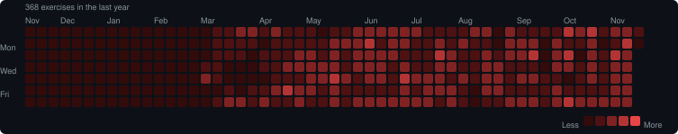

# FitnessStreak

Track and archive my daily fitness history to keep the streak alive.

## Heatmap



## Workflows

| Workflow | Trigger | Description |
| --- | --- | --- |
| [create-daily-pr](.github/workflows/create-daily-pr.yml) | Daily schedule at 6:15 JST | Creates a PR with exercise checkboxes for the day |
| [save-results](.github/workflows/save-results.yml) | PR merged on `fitness/*` branch | Parses PR body checkboxes and saves results to JSON |
| [generate-heatmap](.github/workflows/generate-heatmap.yml) | Push to `results/*.json` / daily at 3:00 JST | Aggregates all JSON files and commits an updated SVG heatmap |

The daily PR is created by the account that owns the `KOTAOUE_TOKEN` repository secret. Set it to a fine-grained personal access token owned by `kotaoue` with access to this repository and **Contents: read and write** and **Pull requests: read and write** permissions. The PR will continue to be assigned to `kotaoue`.

## Data structure

Each day's record is saved as `results/YYYY-MM-DD.json`:

```json
{
  "date": "2026-01-01",
  "exercises": {
    "ストレッチ": true,
    "ラジオ体操": true,
    "筋トレ": false,
    "運動": true
  }
}
```

## Manual heatmap generation

```bash
python .github/scripts/generate_heatmap.py
```

The script reads JSON files from `results/` and writes the SVG to `results/heatmap.svg`.
Requires Python 3.9+. No third-party packages needed.
